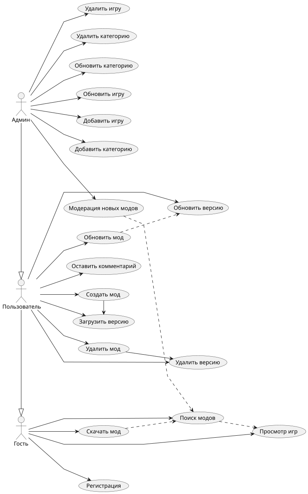
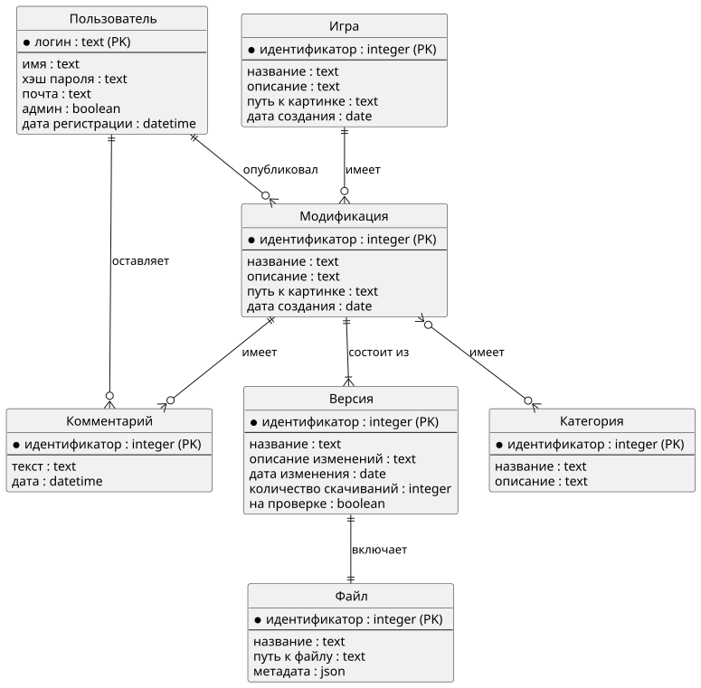
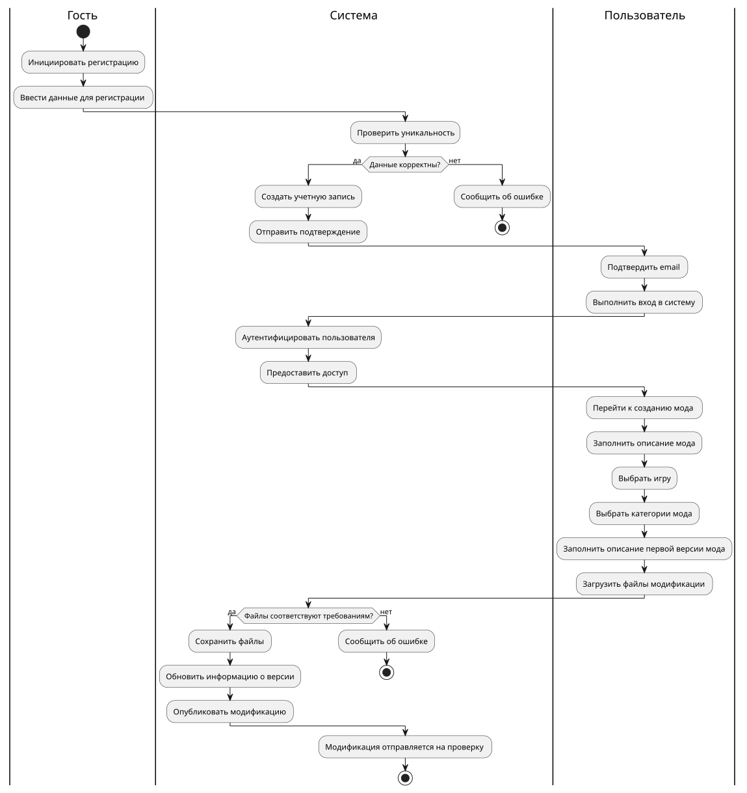

# ModWeave

## Название проекта
ModWeave - платформа игровых модификаций.

## Краткое описание идеи проекта
Веб-платформа для публикации, хранения и распространения пользовательских модов к играм. Пользователи загружают моды с версиями и файлами, оставляют комментарии, скачивают публичные моды.

## Предметная область и сущности
**Предметная область**: платформы моддинга (Modrinth, CurseForge, NexusMods).  
**Основные сущности**:
- **User** – пользователь платформы
- **Game** – игра (Minecraft, Fallout и др.)
- **Mod** – модификация (принадлежит игре и автору)
- **Version** – версия мода с описанием изменений
- **File** – файл принадлежащий какой-то версии мода
- **Comment** – комментарий к моду
- **Category** – категории модов
- **Collection** – упорядоченная подборка модов

## Анализ аналогичных решений

| Критерий | Modrinth                | CurseForge         | Nexus Mods       |
|----------|-------------------------|--------------------|------------------|
| Год основания | 2021                    | 2006               | 2001             |
| Основная аудитория | Minecraft/Fabric        | Minecraft/Forge    | Skyrim/Fallout   |
| API | Открытый REST API       | Открытый REST API  | Открытый API     |
| Модерация контента | Автоматическая + ручная | Ручная             | Ручная           |
| Монетизация | Донаты, премиум API     | Реклама, партнерки | Премиум подписка |

## Обоснование актуальности
Моддинг игр растет, но существующие платформы либо закрыты, либо привязаны к играм. Таким образом необходима открытая платформа не привязанная к какой-либо игре.

## Акторы (роли)
1. **Гость** – просмотр модов, скачивание публичных версий
2. **Авторизованный пользователь** – все как гость + публикация модов и комментариев
3. **Админ** – модерация контента; добавление новых категорий, игр

## Use-Case диаграмма



## ER-диаграмма сущностей



## Пользовательские сценарии

Скачивание мода (гость):
1. гость заходит на главную страницу, выбирает игру из каталога;
2. переходит в раздел модов, применяет фильтры (популярность, дата, категория);
3. открывает страницу мода, читает описание, просматривает версии и комментарии;
4. выбирает последнюю версию, нажимает "скачать";
5. получает ссылку на файл, скачивает его напрямую.

Публикация мода (авторизованный пользователь):
1. пользователь нажимает кнопку "опубликовать мод";
2. переходит на страницу создания модификации; выбирает игру из списка; вводит название мода и первой версии, описание; выбирает категории;
3. нажимает кнопку "опубликовать";
4. мод отправляется на проверку.

Проверка модов (админ):
1. админ заходит в админ-панель;
2. жмет кнопку "модификации на проверке";
3. переходит в карточку очередной модификации;
4. проверяет название, описание, файлы;
5. подтверждает или отклоняет опубликованную модификацию.

## BPMN



## Структура проекта

Три Gradle-модуля в каталоге `layers` сохраняют границы слоёв лабораторной №3:

```text
layers/
  api/src/main/kotlin/         HTTP-контроллеры, DTO, HATEOAS, security
    category/                 CategoryController и DTO категории
    common/                   пагинация ссылок, HTTP-валидаторы, ошибки
    security/                 стандартный Spring Security Resource Server
    …                         остальные предметные разделы
  domain/src/main/kotlin/      доменные модели, сервисы, команды, интерфейсы Repository
  persistence/src/main/kotlin/ JPA-сущности, реализации Repository, S3 и outbox
src/main/kotlin/               запуск приложения и конфигурация кэша
src/test/kotlin/               HTTP-контракт, регрессии, репозитории, хранилище
openapi/                      единственный исходный контракт и Arazzo-сценарий
```

Общий префикс `git.walhay.modweave` сохранён в Kotlin-пакетах, но не повторяется каталогами внутри каждого source root. Например, файл `layers/api/src/main/kotlin/category/CategoryController.kt` имеет пакет `git.walhay.modweave.api.category`. Внутри предметного раздела DTO и контроллер лежат рядом; служебные уровни `http/dto/command/exception/repository` убраны. `api` и `persistence` зависят от `domain`, друг от друга не зависят. Приложение собирает все три модуля. Gradle-пути `:api`, `:domain`, `:persistence` сохранены: `layers` группирует каталоги и не является отдельным подпроектом.

Сервисы внедряются по классам: интерфейсы с единственной реализацией убраны. Интерфейсы Repository и хранилища сохранены для отделения БД/S3 и тестовых реализаций. Небольшие команды и исключения сгруппированы в файлах `*Commands.kt`; запросы авторизации и категории — в `AuthDtos.kt` и `CategoryRequestDtos.kt`. Общие настройки Kotlin, JDK и BOM заданы один раз в корневом Gradle-файле. Домен использует Spring Data Commons и транзакции без зависимости от JPA.

## Запуск

Нужны JDK 25, Node.js 22.12+ и Docker. Сборка скачивает закреплённый Redocly CLI через `npx`.

```sh
docker compose -f docker/docker-compose.yaml up -d
export JWT_SECRET="$(openssl rand -base64 32)"
./gradlew bootRun
```

Swagger UI: **http://localhost:8080/api/v2/docs**. Исходник — [openapi/openapi.yaml](openapi/openapi.yaml); Gradle проверяет и собирает его, затем включает в JAR по адресу `/api/v2/openapi.yaml`. UI и ресурсы Swagger поставляются локальным WebJar.

Подключения задаются через `DB_URL`, `DB_USER`, `DB_PASSWORD`, `REDIS_HOST`, `REDIS_PORT`, `S3_ENDPOINT`, `S3_ACCESS_KEY`, `S3_SECRET_KEY`, `S3_REGION`. Значения по умолчанию соответствуют Compose. PostgreSQL создаёт схему из `sql/init.sql` и `sql/storage-cleanup.sql` при первом запуске на пустом томе. Загружаемые файлы ограничены 100 МБ, весь multipart-запрос — 500 МБ. Принимаются PNG/JPEG; содержимое изображения проверяется, повреждённое изображение возвращает 400.

Секрет JWT — Base64 не менее 32 случайных байт. Сохраняйте его между перезапусками. Подпись и проверка HS256 выполняются `NimbusJwtEncoder`/`NimbusJwtDecoder`; bearer-аутентификация — встроенным OAuth2 Resource Server. Проверяются issuer, срок, subject и тип токена: access действует 15 минут, refresh — 30 дней и принимается только `/auth/refresh`. Роли и доступность аккаунта перечитываются при аутентификации. Неверный bearer возвращает 401 с `WWW-Authenticate`.

Чтобы проверить модерацию, зарегистрируйте пользователя и назначьте ему `is_admin = true` в `modweave.users`. Повторный вход не обязателен: следующий запрос проверит текущую роль. Категориями, играми и модерацией управляет администратор. `sql/roles.sql` демонстрирует отдельно роли PostgreSQL; это не роли API.

Обе версии доступны одновременно:

```sh
curl http://localhost:8080/api/v1/categories
curl http://localhost:8080/api/v2/categories
```

В v1 категории — массив; в v2 — `{items, _links}`. В v2 создание адресуемого ресурса возвращает 201 с `Location`, удаление — 204. Категория создаётся JSON, PATCH принимает ровно `description` (строка или null). Вставка мода в коллекцию — POST `/api/v2/collections/{id}/mods` с JSON `{"modId":"example-mod","index":0}`; пропуск `index` добавляет в конец. Модерация — PATCH версии с JSON `{"status":"APPROVED"}` или `REJECTED`. Остальные формы и multipart описаны в Swagger UI. TUI и GUI в текущем репозитории отсутствуют.

Ошибки возвращаются как `application/problem+json` (Spring `ProblemDetail`): `title`, `status`, `instance` и при наличии `detail`. Если `type` отсутствует, по RFC 9457 он равен `about:blank`. Это касается также ошибок bearer-аутентификации; стандартный `WWW-Authenticate` сохранён. Доменные исключения обрабатываются в одном `GlobalExceptionHandler`, ошибки HTTP и валидации — его базовым классом Spring. Коды ошибок v1 сохранены, тела приведены к тому же формату.

## HATEOAS, видимость и кэширование

Ресурсы v2 содержат `_links` с `href` и `method`; вложенные элементы и файлы также имеют ссылки. `ApiResourceAssembler` реализует стандартный `RepresentationModelAssembler` и объединяет DTO со ссылками в `EntityModel`. DTO содержат данные без логики построения ссылок. Общая функция `apiLink(Controller::method, ...)` использует `WebMvcLinkBuilder.linkTo`: путь, параметры и HTTP-метод берутся из аннотаций контроллера. Она применяется также к `Location` и файловому заголовку `Link`; общий префикс `/api/v2` учитывается в одном месте. Маленький `ApiModel` сохраняет форму `_links` из OpenAPI, страницы сохраняют плоские поля `PageResponseDto`. Ссылки списков включают обязательные `page` и `size`; навигация страниц сохраняет фильтры и повторяемый `sort`. Действия управления отображаются с учётом пользователя. Общий advice выбирает представление v2 и добавляет HTTP-кэширование, v1 возвращает прежние DTO. Выбор объяснён в [ADR-002](docs/architecture/decisions.md#adr-002-spring-hateoas-с-сохранением-openapi).

До появления хотя бы одной APPROVED-версии мод видят только автор и администратор. Для остальных карточка и список версий возвращают 404, мод отсутствует в каталогах, комментарии скрыты. Неодобренные версии и файлы доступны только автору/администратору даже у публичного мода. Отзыв последнего одобрения снова скрывает мод.

GET v2 возвращает `Cache-Control: private, no-cache`, `Vary: Authorization` и ETag, вычисленный по представлению. Повторный `If-None-Match` может вернуть 304 без тела; проверка доступа выполняется до этого. Для файлов 304 не читает S3 и не увеличивает счётчик. Только файлы возвращают `Last-Modified` — дату загрузки версии. У JSON-ресурсов нет достоверного `updatedAt`, поэтому дата изменения не подставляется. Проверка кэша использует ETag, без `If-Modified-Since` и хранения валидаторов в памяти процесса.

RedisCacheManager создаёт Spring Boot: TTL `1h`, префикс `modweave:domain-v2:` и запрет кэширования null задаются через `spring.cache.redis`. Единственный builder customizer откладывает изменение кэша до commit транзакции. Старые сериализованные объекты после переноса пакетов истекут по прежнему TTL; схема БД не меняется.

Logback использует автоконфигурацию Spring Boot и `logging.*`: `LOG_FILE`/`LOG_PATH`, ротация 10 МБ, хранение 30 дней, общий предел 1 ГБ. В dev/default работают консоль и файл, в prod — файл, в test — консоль. Отдельный XML не нужен.

## Проверки лабораторных №2 и №3

```sh
# Линтер OpenAPI и проверка примеров по схемам, без сервера:
./gradlew lintOpenApi buildOpenApi

# Mock: оставить работающим в первом терминале:
./gradlew mockOpenApi
# Во втором терминале — 6 шагов Arazzo-сценария:
./gradlew testOpenApi

# Полная проверка с изолированными PostgreSQL и SeaweedFS через Testcontainers:
./gradlew check ktfmtCheck bootJar

# Только HTTP-контракт:
./gradlew test --tests 'git.walhay.modweave.integration.ApiContractTest'
# Без Docker — регрессионные тесты:
./gradlew test --tests 'git.walhay.modweave.regression.*' ktfmtCheck
```

Отчёт JUnit: `build/reports/tests/test/index.html`. Контрактный тест выполняет все 37 operationId на настоящем сервере. Стандартный OpenAPI-валидатор проверяет статусы, JSON-схемы ответов, обязательные заголовки, пути, query-параметры и JSON/urlencoded-запросы по собранному YAML. Multipart обрабатывает настоящий сервер: сценарии проверяют загрузку и скачивание байтов, повреждённые изображения и превышение лимита. Проверяются CRUD, PATCH/null, ошибки и роли, HATEOAS, пагинация, 304, видимость после модерации, JWT, v1/v2 и Swagger.

Проверка чувствительности удаляет обязательные поля и заголовки, меняет тип поля, Content-Type и статус, добавляет запрещённое поле вложенной ссылки. Все эти нарушения должны быть обнаружены; допустимые дополнительные поля остаются допустимыми. Отдельный эксперимент с намеренно неверным статусом в контроллере описан в отчёте.

[Проверка требований, сценарии и решения](docs/lab-review.md), [контекст агента](AI_CONTEXT.md), [ревью ИИ-трека](AI_REVIEW.md). Лабораторные №4 и далее и необязательный GraphQL не входят в эту работу.
